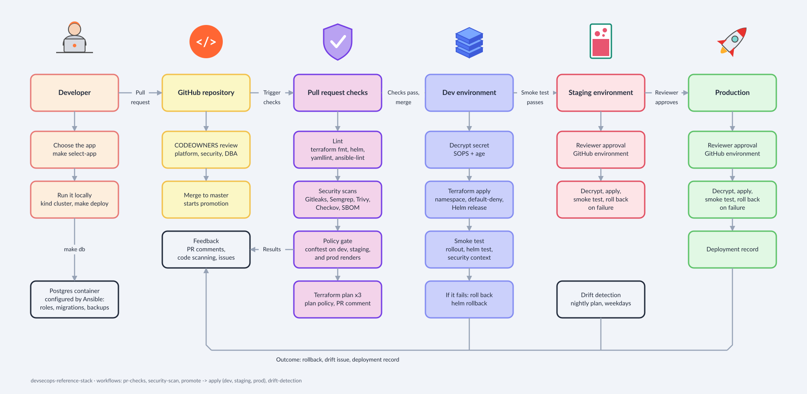

# devsecops-reference-stack

A small, runnable DevSecOps stack I built as a reference implementation: a
containerized service deployed to a local Kubernetes cluster by Terraform and
Helm, a Postgres database managed by Ansible, secrets encrypted at rest with
SOPS, and a CI/CD pipeline that promotes Terraform changes dev to staging to
prod behind peer review, tests, and policy checks.


## Concepts Covered

| Area | Where to look |
|---|---|
| Kubernetes from scratch | `kind/cluster.yaml`, `docs/K8S_FROM_SCRATCH.md` |
| Helm chart authoring | `helm/paymentsvc/` |
| Deploying a real application instead of the stand-in | `apps/`, `scripts/select-app.sh` |
| Terraform, three environments | `terraform/envs/`, `terraform/modules/app/` |
| Ansible with Postgres | `ansible/`, `db/migrations/` |
| Secrets management | `docs/SECRETS.md`, `.sops.yaml`, `scripts/` |
| CI/CD with review gates | `.github/workflows/`, `.github/CODEOWNERS` |
| Policy as code | `policy/` (Rego, run with conftest) |
| Monitoring and success criteria | `docs/MONITORING.md` |
| Decisions and tradeoffs | `docs/adr/` |
| Threat model | `docs/THREAT_MODEL.md` |
| Auditing the stack with my own toolkit | `docs/SECURITY_AUDIT_STEPS.md`, `findings/` |
| Self-audit: why a second repository checks this one | `docs/SECURITY_AUDIT_OVERVIEW.md` |
| What I would fix next, and why | `docs/REVIEW_NOTES.md` |
| The spec this repo answers to, and the prompts that rebuild it | `spec/` |

## Design Approach: Spec-driven

The capabilities of this repo were created using a set of spec files that were created from a Product owner perspective and the following directive: This repo should provide a solid DevSecOps foundation for a pipeline that can vet applications early in the development process. 
`spec/SPEC.md` states purpose, constraints, and invariants; 
`spec/FEATURES.md`
lists every feature with checkable acceptance criteria; 
`spec/prompts/` is the numbered prompt sequence that recreates the repository slice by slice, plus a
template for modifying one feature. 
`make spec-check` tests the mechanical criteria. The spec was extracted from the code after the first build and leads from then on; 
`spec/CHANGE-PROTOCOL.md` says how.

## Software Requirements

Docker, kind, kubectl, helm 3, terraform 1.6+, ansible-core 2.16+, sops, age,
conftest, and `psycopg2-binary`. `scripts/bootstrap.sh` checks for each one
and tells you what is missing.

## The Pipeline at a Glance



A pull request runs lint, security scans, the policy gate, and a Terraform
plan for each environment, and needs CODEOWNERS approval to merge. The merge
promotes the same commit to dev, staging, and prod in that order. Each
environment decrypts its secret, applies, and runs the smoke test, and rolls
back if the test fails. Staging and prod also wait for a reviewer. Results,
rollbacks, drift issues, and deployment records come back to the pull request
and the issue tracker.

### What differs between environments

All three environments run the same `apply.yml` job; only the `environment`
input changes. The table follows the diagram's phases. **Bold** marks a
difference in behavior; the rest differ only by name.

| Phase | Dev | Staging | Prod |
|---|---|---|---|
| Review: code owners of the Terraform root | platform-team | platform-team | **platform-team and security-team** |
| Pull request checks: Terraform plan | `dev-plan` environment | `staging-plan` environment | `prod-plan` environment |
| Pull request checks: policy gate | **single-replica warning** | passes clean | passes clean |
| Promotion starts | **on merge to main** | after dev succeeds | after staging succeeds |
| Approval before apply | **none** | **required reviewers** (set in GitHub, not in code) | **required reviewers** (set in GitHub, not in code) |
| Decrypt secret | `secrets/dev.enc.yaml` | `secrets/staging.enc.yaml` | `secrets/prod.enc.yaml` |
| Terraform apply: root and state | `terraform/envs/dev` | `terraform/envs/staging` | `terraform/envs/prod` |
| Terraform apply: namespace | `paymentsvc-dev` | `paymentsvc-staging` | `paymentsvc-prod` |
| Terraform apply: `owner` label | platform | platform | **payments** |
| Workload: replicas | **1** | **2** | **3** |
| Workload: pod disruption budget | **off** | **minAvailable 1** | **minAvailable 2** |
| Workload: CPU and memory | chart defaults | chart defaults | **200m / 128Mi requested, 500m / 256Mi limit** |
| Workload: log level | **debug** | **info** | **warn** |
| Workload: `payments-v2` flag | on | on | **off** |
| Workload: database | `paymentsvc_dev` | `paymentsvc_staging` | `paymentsvc_prod` |
| Smoke test and rollback | same in all three | same in all three | same in all three |

The values come from `helm/paymentsvc/values-<env>.yaml`,
`terraform/envs/<env>/main.tf`, `.github/CODEOWNERS`, and the workflows.

## How to Run it

```bash
./scripts/bootstrap.sh          # preflight checks
make cluster                    # kind cluster + registry-less local images
make select-app                 # optional: a real application instead of the stand-in
make db                         # Postgres container + Ansible roles + migrations
make deploy ENV=dev             # terraform apply against the kind cluster
make smoke ENV=dev              # post-deploy checks
make policy                     # helm template | conftest test
make destroy                    # tear everything down
```

Each `make` target prints the underlying command before running it, so a
screenshare viewer can see exactly what is happening.

### Choosing the application

The pipeline deploys a stand-in service (`nginx-unprivileged`) unless you
select a real one. `make select-app` asks for a published image
(`repository:tag`) or a local directory with a Dockerfile, then the port,
health path, and writable directories, and writes a profile to `apps/`. It
policy-checks all three environments with the profile before selecting it;
`make plan`, `deploy`, `policy`, and `destroy` use it from then on.
`make select-app ARGS=--standin` goes back. What a real application has to
accept to pass the same gates is in `apps/README.md`; `apps/podinfo.yaml` is
a worked example.

## Bonus: Audited with my own tooling

This stack is audited by an AI-assisted review tool. It lives in a second repository of mine, named `security-engineer-toolkit`. It provides 1) An open-source practice environment and working toolkit for security engineers who pair with AI coding agents. 2) A sandbox that enables engineers to safely run and assess security vulnerabilities for a specific repo. 

This repo contains a set of reusable slash commands for Claude Code (a stack-agnostic security sweep, a guided fix session, a remediation write-up), a disposable Docker sandbox for running code you do not trust yet, and CI workflow templates. It analyzes
source code; it does not run the application or attack a live system.

That pairing matters here because **this repository was generated in a Claude
Code session**, which is the exact case the toolkit treats as its own
category: not twenty years of accumulated legacy risk, but one generation
process that may have introduced something. Framework misconfiguration,
permissive defaults, and credentials hardcoded while the code was being
written are the realistic risks, and the toolkit leads with those rather than
with a generic vulnerability checklist.

**What you need to use it here.** Claude Code, installed and signed in; a
container engine (Rancher Desktop, Podman Desktop, or Docker Desktop); and a
clone of the toolkit beside this repository. Copy its commands into
`~/.claude/commands/`, copy its sandbox settings block into this repo's
`.claude/settings.json`, and you have everything. No account, no license, no
network service.

**How the two interact, from 10,000 feet.** They meet at three seams, and
nowhere else.

1. **Source in, findings out.** You run the toolkit's commands from inside
   this repository. They read the shell scripts, the Ansible templating, and
   the generated application code, and they produce findings: a file, a line,
   a CWE, a reason. Nothing is written to this repository except what you
   choose to record in `findings/`.
2. **Findings become enforcement.** A finding ends in one of three places: a
   fix, a new rule in `policy/` that fails the build if it recurs, or an
   accepted risk written into `docs/THREAT_MODEL.md`. The second is the
   valuable one, because a policy rule cannot regress silently the way a
   memory of a code review can.
3. **A shared CI template.** The toolkit's `security-scan.yml` is vendored
   here unmodified as `.github/workflows/security-scan.yml`: Gitleaks,
   Semgrep, Trivy, and an SBOM, with every action pinned by commit SHA and
   every scanner binary checksum-verified. It is updated by re-copying, never
   by editing in place.

The division of labor is deliberate, and each repository states its own
limits. The toolkit reviews code before it ships and says plainly that it does
no dynamic testing, no release-integrity work, and nothing at runtime. This
stack is the other half: the gates, the tests, the promotion controls, and the
runtime posture. `docs/SECURITY_AUDIT_STEPS.md` is the step-by-step loop;
`docs/SECURITY_AUDIT_OVERVIEW.md` is the one-page version of this argument.

**Provenance.** I wrote this in October 2026 to have one place where the whole
pipeline is visible end to end. The Terraform, CI/CD, SAST and policy-as-code
patterns come from client work. The Helm chart authoring and the Ansible
database roles are newer to me: I have used Helm to install and upgrade
existing charts and Argo CD to deploy through an existing GitOps setup, and
this repo is where I wrote charts and playbooks of my own. Nothing here is
client code.
